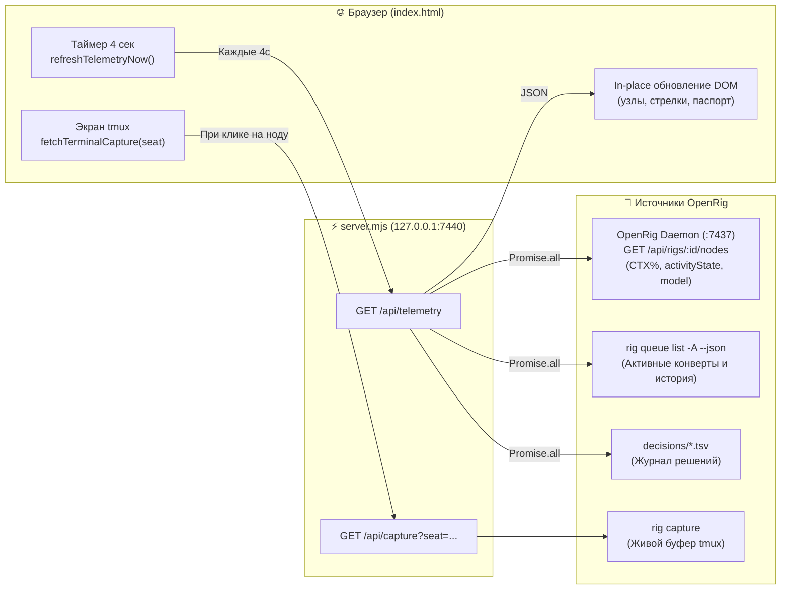

# OpenRig Neural Command Deck (`@openrig/deck`)

Футуристичный интерактивный Control Plane и командный дашборд оператора для любых мульти-агентных кластеров **OpenRig** (универсальная отвязка от конкретного проекта по [ADR-0007](docs/adr/0007-universal-rig-decoupling.md)).

## Структура проекта и документации

- [`index.html`](./openrig/index.html) — интерактивный дашборд **OpenRig // Neural Command Deck v3.1** (Action-First триаж-полоса Top-3, Live vs Ghost Sankey-магистрали, динамические резервуары квот моделей, радар блокеров «Кто → Кого ждёт», живой Паспорт узла с захватом `tmux` и тревожными знаками).
- [`server.mjs`](./openrig/server.mjs) — локальный универсальный сервер телеметрии на чистом Node.js (порт `7440`), объединяющий daemon API (`:7437`), очередь `rig queue`, буферы `tmux`, динамический резолвер руководств (`AGENTS.md`) и журнал решений.
- [`package.json`](./openrig/package.json) — конфигурация автономного пакета `@openrig/deck` с исполняемым бинарником `openrig-deck` (Zero Dependencies).

### Документация проекта:
- [🌲 Спецификация полного дерева UI](./openrig/docs/ui-component-tree-specification.md) — исчерпывающее дерево компонентов (каждый элемент DOM, поля данных, физический смысл, условия отображения, режимы Fit/Detailed, горячие клавиши).
- [🛡️ Архитектурный Diligence Review](./openrig/docs/architecture-diligence-review.md) — официальный аудит архитектуры (Evidence Ladder, глубокие швы, инварианты владения очереди и памяти RECAP, доказательства P1–P4).
- [🧠 Анализ когнитивной нагрузки UX](./openrig/docs/ux-cognitive-load-analysis.md) — эргономика восприятия по модели CLT Свеллера и Endsley SA (горизонты 0..3, трение сенсорной усталости, разгрузка оператора).
- [🏛️ Архитектурные решения (ADR)](./openrig/docs/adr/README.md) — реестр решений ADR-0001 .. ADR-0007 (Pure Vanilla, трёхзвенный мост, in-place DOM patching, безопасность control plane, dynamic discovery, Action-First иерархия, Universal Decoupling).
- [🎯 Продуктовое описание](./openrig/docs/product/overview.md) — миссия продукта, решение проблемы «слепоты терминалов», карта функциональных модулей.
- [👤 Руководство оператора](./openrig/docs/user-guide/operator-guide.md) — как читать радар, расшифровка состояний (Working, Idle, Held, Parked, Needs Input), работа с мини-терминалом и быстрыми клавишами.
- [💻 Руководство разработчика](./openrig/docs/dev-guide/architecture-and-api.md) — контракты эндпоинтов `/api/telemetry`, `/api/capture`, `/api/send`, математика векторного SVG-холста и правила расширения.
- [📐 Информационная архитектура](./openrig/docs/information-architecture.md) — принципы Calm HUD, цветовая семиотика и метафоры резервуаров.
- [🗺️ Карта архитектуры рига](./openrig/docs/architecture.md) — диаграммы взаимодействия узлов контура `core-platform` + `kernel`.

## Быстрый запуск

1. **Запустить сервер живой телеметрии (`http://127.0.0.1:7440`):**
   ```bash
   node ~/www/agenticos/openrig/server.mjs
   ```
   После этого откройте в браузере `http://127.0.0.1:7440`.

2. **Автономный просмотр (Snapshot Mode):**
   ```bash
   open ~/www/agenticos/openrig/index.html
   ```

---

## Как устроена синхронизация данных между страницей и ригом

Синхронизация работает в **три звена** без сторонних зависимостей:



### 1. Сборщик телеметрии: [`server.mjs`](./openrig/server.mjs) (`:7440`)
На каждый запрос `GET /api/telemetry` ([`server.mjs#L154-L183`](./openrig/server.mjs#L154-L183)) сервер параллельно (`Promise.all`) опрашивает 4 живых источника:
1. **Нативный HTTP API демона OpenRig (`127.0.0.1:7437`):**
   - `GET /api/rigs/01M67K8ARXGTK4NFKC1C0NZP4X/nodes` (`core-platform`)
   - `GET /api/rigs/01M497NCDWB4JA5FN1VPSTG6QY/nodes` (`kernel`)
   - Это **тот же самый внутренний эндпоинт**, который читает `rig tui`. Отсюда приходят:
     - `contextUsage.usedPercentage` и `contextWindowSize` (точные проценты нагрева контекста 1:1 с TUI);
     - `activityState.display` и `agentActivity` (`idle`, `working`, `running` — работает ли узел прямо сейчас);
     - `needsAttention` (ждёт ли агент ручного подтверждения человека в терминале);
     - `modelObservation.model`, `effort`, `assignedWorkCount`, `lastActivityAt`, `tmuxAttachCommand`.
2. **Активная очередь (`rig queue list -A --json`):**
   - Возвращает открытые прямо сейчас конверты (`pending` / `in-progress`), маршрут передачи (`sourceSession → destinationSession`), тег слайса (`slice:...`) и краткое описание (`summary`).
3. **Журнал архитектурных решений ([`readRecentDecisions`](./openrig/server.mjs#L46-L77)):**
   - Читает последние записи напрямую из TSV-файлов в `<rig-dir>/decisions/*.tsv`.
4. **Историческая статистика очереди ([`getHistoryStats`](./openrig/server.mjs#L139-L148), с кэшем на 20 сек):**
   - Вызывает `rig queue list -a -A --limit 300 --json` и агрегирует матрицу частоты вызовов между парами агентов (`pairCounts`) и число кругов возврата на доработку у кодеров (`coderStats`).

### 2. Живой захват экрана терминала (`GET /api/capture`)
При клике по любой ноде на карте или нажатии кнопки `🔄 Экран`:
- Браузер вызывает `GET http://127.0.0.1:7440/api/capture?seat=<id>&lines=32` ([`server.mjs#L186-L202`](./openrig/server.mjs#L186-L202)).
- Сервер выполняет `rig capture <seat> --lines 32`, снимает реальный буфер `tmux`-панели выбранного агента и отображает его в Паспорте узла.

### 3. Цикл обновления в браузере: [`index.html`](./openrig/index.html)
- Каждые **4 секунды** таймер `setInterval(refreshTelemetryNow, 4000)` ([`index.html#L1913-L2064`](./openrig/index.html#L1913-L2064)):
  1. Обновляет `ctxPct`, статус (`❤️ WORKING` / `Zzz... IDLE` / `🚨 NEEDS INPUT`), модель и счётчики задач у каждого узла.
  2. Пересчитывает активность маршрутов (`EDGES`): стрелка включает анимацию потока (`liveActive = true`) только тогда, когда по ней реально идёт открытая задача в `activeQueue` или работает целевой кодер.
  3. Обновляет DOM-карточки узлов **на месте (in-place)** в [`renderTopology()`](./openrig/index.html#L1528-L1580), чтобы не сбрасывать CSS-анимации биения сердца и `Zzz...` и не прерывать клики мыши.
  4. Если `server.mjs` недоступен, страница автоматически переключается в `⚡ SNAPSHOT MODE` и продолжает работать на последнем сохранённом снимке.

### 4. Harness-Aware командная панель и гигиена ввода ([ADR-0008](./openrig/docs/adr/0008-harness-aware-command-dispatching.md))
- **Адаптивные клавиатуры под харнес:** Автоматически подстраивает доступные кнопки быстрого ввода под тип агента:
  - **Codex:** нативные `/compact`, `/new`, быстрые ответы `1 (Proceed)`, `y (Yes)`.
  - **Claude Code:** `/compact`, `/clear`, `/cost`, интерактивные ответы.
  - **Pi (DeepSeek):** заблокирован ввод слэш-команд во избежание засорения контекста рассуждений; компактификация направляется в безопасную ротацию сиденья (`rig seat launch <seat> --fresh --stop --reason "context rotation"`).
  - **AGY (Antigravity):** `/compact`, `/effort high`, системные команды.
- **Гигиена буфера строки (`C-u`):** Устраняет проблему дублирования команд (например, `/compact/compact`) за счёт принудительной очистки строки Unix readline перед отправкой команды в tmux-сессию и серверной нормализации токенов.

### 5. Fleet Intelligence & Autonomous Advisory Engine ([ADR-0009](./openrig/docs/adr/0009-fleet-intelligence-and-advisory-engine.md))
- **Аналитика топологии и заторов:** Выявление узких горлышек в очереди ревью (Wait-to-Work Ratio), балансировка потоков задач и рекомендации по динамическому масштабированию (`dev-check2`) или парковке фантомных узлов.
- **Оптимизация бюджета (Model-Task Fit):** Предотвращение сжигания квот дорогих Frontier-моделей (GPT-6 Sol, Claude 3.7) на тривиальных задачах (линтинг, форматирование, документация) за счёт маршрутизации на Open-Weights модели (DeepSeek, GLM).
- **Контроль токсичного контекста и качества:** Математическая корреляция нагрева контекста (> 68% CTX) с кратными возвратами от QA, превентивная компактификация перед взятием слайса.
- **Интерфейс действий в 1 клик:** Оперативный стрип рекомендаций с расчётом ROI (экономия времени и бюджета) и готовыми управляющими директивами. Подробнее: [Онтология флота](./openrig/docs/fleet-intelligence-ontology.md), [Архитектура модуля](./openrig/docs/fleet-intelligence-architecture.md) и [Продуктовое описание](./openrig/docs/product/fleet-intelligence.md).
