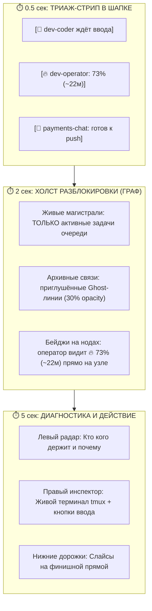

# ADR-0006: Action-First визуальная иерархия, Триаж-стрип и дифференциация живых магистралей

**Статус:** `[ACCEPTED]`  
**Дата:** 7 ноября 2026 г.  
**Контекст системы:** OpenRig Neural Command Deck v3.2 (`./openrig/`)  
**Связанные документы:** 
- [ADR-0001: Pure Vanilla JS + SVG Canvas](0001-pure-vanilla-svg-architecture.md)
- [ADR-0003: In-place DOM Patching](0003-in-place-dom-mutations.md)
- [ADR-0005: Динамический подхват топологии](0005-dynamic-rig-topology-discovery.md)
- [Анализ когнитивной нагрузки UX](../ux-cognitive-load-analysis.md)
- [Информационная архитектура](../information-architecture.md)

---

## 1. Контекст и проблема

В ходе боевой эксплуатации и экспертного UX-аудита дашборда на живом риге (`core-platform` + `kernel`) был выявлен структурный дисбаланс визуального внимания оператора:

1. **Дисбаланс площади и полезного действия:**
   Центральный SVG-граф занимает свыше **60% полезной площади экрана** 1920×1080, однако ответ на главный рабочий вопрос оператора — **«Где прямо сейчас требуется моё вмешательство?»** — приходится собирать по периферии: левая колонка («Кто $\rightarrow$ Кого $\rightarrow$ Зачем ждёт»), правая панель инспектора и нижние дорожки слайсов.
2. **Семиотическая двусмысленность магистралей (Ambiguity of Motion):**
   Яркие светящиеся линии связей притягивают взгляд, но оператору сложно с первого взгляда дифференцировать:
   * *Летит ли пакет задачи прямо сейчас в реальном времени?*
   * *Или это просто статистическая линия, отражающая историю из 19 архивных вызовов за смену?*
3. **Растворение критических предупреждений в общем визуальном шуме:**
   Критически важный сигнал — например, нагрев контекста оператора рига `dev-operator` до **73% с прогнозом ~22 минуты до порога автосжатия 75%** — на общем красочном полотне визуально подавляется нерелевантными элементами и может быть пропущен.

---

## 2. Рассмотренные альтернативы

### Альтернатива 1: Радикальное сокращение графа в мини-карту (Thumbnail Minimap)
Свернуть граф в компактный виджет в углу экрана, а освободившиеся 70% площади отдать под терминалы и списки очередей.  
* **Почему отклонено:** Теряется целостная ситуационная осведомленность (Endsley Level 1 SA). Граф критически необходим для пространственного понимания топологии (Tier 1 Оркестратор $\rightarrow$ Tier 2 QA $\rightarrow$ Tier 3 Кодеры) и архитектурных швов между сервисами.

### Альтернатива 2: Модальные всплывающие окна тревоги (Alert Dialogs / Popups)
При возникновении любого блокера или нагрева выше 70% выбрасывать блокирующее модальное окно.  
* **Почему отклонено:** Нарушает принципы **Calm Technology**. Модальные окна прерывают поток мысли оператора, блокируют просмотр других узлов и вызывают усталость от предупреждений (Alert Fatigue).

### Альтернатива 3 (Принято): Архитектура «Action-First Topology»
Сохранить целостный граф и футуристичную эстетику космического командного центра, но принципиально изменить **порядок визуального сканирования (Scanning Order)**:
1. Вынести на самый верхний горизонт компактный **Триаж-стрип (Top-3 Actionable Triage Strip)**.
2. Ввести строгую визуальную сегрегацию магистралей: **«Живое действие» (Live Transit) vs «Архивный след» (Ghost Highway)**.
3. Отображать бейджи срочности (`🔥 73% (~22м)`) прямо на теле карточек нод на графе.

---

## 3. Принятое архитектурное решение

Принята парадигма **«Action-First Visual Hierarchy»**, включающая 3 согласованных механизма:

### Механизм 1: Интерактивный триаж-стрип «Топ-3 внимания» (Top-3 Triage Strip)
В верхней строке интерфейса (непосредственно под шапкой) разворачивается динамический блок из трёх ранжированных карточек прямого действия:

$$\text{Triage Rank} = f(\text{Severity}, \text{Time-to-Limit}, \text{Blocker Status})$$

* **Приоритет 1 (P0 — Остановка / Ждёт человека):**
  `🚨 <Узел>: ждёт подтверждения в терминале`  
  *Клик*: мгновенно выбирает узел, разворачивает его терминал и подсвечивает контекстную кнопку ввода (`[1] Proceed` или `[y] Yes`).
* **Приоритет 2 (P1 — Термический риск контекста):**
  `🔥 <Узел>: 73% (до порога 75% осталось ~22 мин)`  
  *Клик*: разворачивает вкладку сжатия и предоставляет 1-click кнопку `[⚡ rig compact <seat>]`.
* **Приоритет 3 (P2 — Готовность к релизу / Финал слайса):**
  `🎯 <Слайс>: принят QA (остался 1 шаг до push в dev)`  
  *Клик*: подсвечивает связанный слайс, фильтрует граф по участникам и копирует проверочную команду git-приёмки.

### Механизм 2: Двухуровневая сегрегация связей (Live vs Ghost Highways)
Разделение визуального канала магистралей связей на два физически различимых состояния:

| Состояние магистрали | Визуальное кодирование | Назначение |
| :--- | :--- | :--- |
| **Живое действие (Live Transit)** | Яркий неоновый контур (`#00ff9d` изумруд / `#00f0ff` циан), активная CSS-анимация направленного пунктира, контрастная плашка текущей задачи `[slice: <name>]`. | Обозначает передачу, происходящую **прямо сейчас в очереди**. Оператор не сомневается: пакет в пути. |
| **Архивный след (Ghost Highway)** | Тонкая полупрозрачная линия (`#334155`, opacity 0.35), статичная, без свечения и без бегущих импульсов. | Сохраняет топологическую связность рига. Счётчик вызовов (`⚡ 19 выз.`) и история конвертов всплывают **только при hover** или клике на узел. |

### Механизм 3: Прямая термоиндикация на карточках узлов (In-Graph Thermal Badge)
Если узел нагрет свыше 65% и расчётный темп сгорания контекста положителен:
* На самой карточке ноды в графе (рядом с именем и харнесом) отображается пульсирующий шильдик: `🔥 73% (~22м)`.
* Оператор считывает риск мгновенным расфокусированным взглядом за **0.5 секунды**, без необходимости выделять узел и изучать правый инспектор.

---

## 4. Диаграмма взаимодействия и порядка чтения

---

## 5. Последствия решения

### Положительные (Pros):
- **Снижение времени отклика оператора (Mean Time to Triage):** С 15–20 секунд (блуждание по углам) до **1–2 секунд** благодаря верхнему триаж-стрипу.
- **Полная ликвидация ложного внимания:** Оператор больше не путает архивный трафик за смену с живой передачей задачи.
- **Предотвращение аварийных автосжатий:** Сигнал нагрева `dev-operator` виден сразу в двух местах (триаж-стрип и карточка ноды), что позволяет вызвать превентивный `/compact` в безопасной точке idle.
- **Сохранение эстетики:** Дашборд остаётся визуально привлекательным командным пунктом, но его декоративные элементы подчинены функциональному триажу.

### Отрицательные и компромиссы (Cons & Trade-offs):
- Необходимость постоянного пересчёта приоритетов триажа на стороне клиента в `updateAlertsAndTitle()`.
- Усложнение логики отрисовки SVG: магистрали требуют раздельной классификации (`edge.liveActive` строго по открытым строкам очереди против архивных `pairCounts`).

---

## 6. Приёмка и статус

Решение принято единогласно на основании результатов стресс-тестирования оператора и внешней экспертизы. Документ вступает в силу немедленно как спецификация для ревизии интерфейса v3.2.
