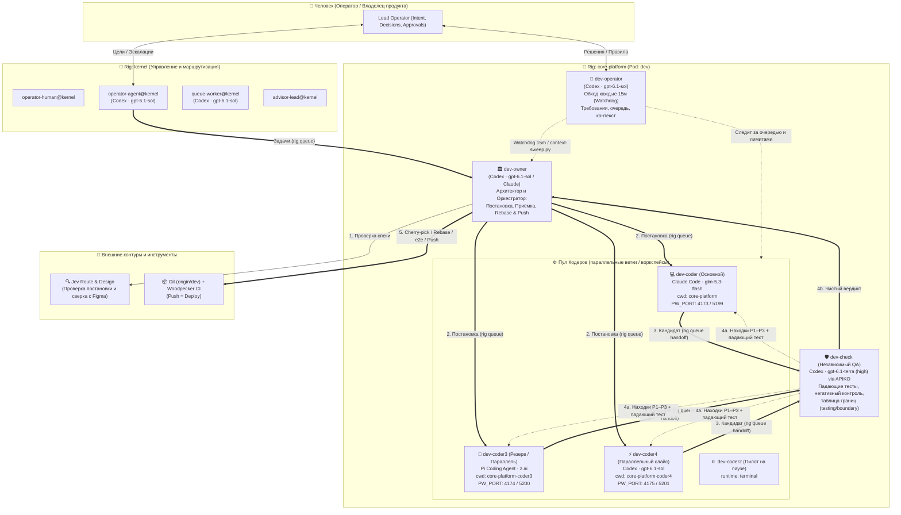
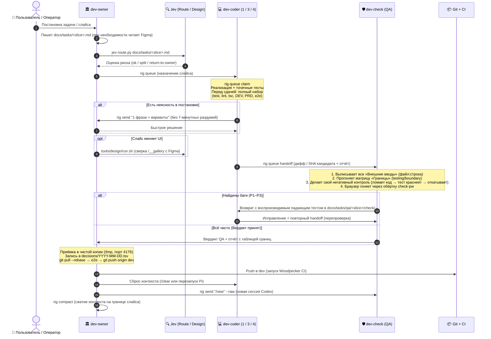
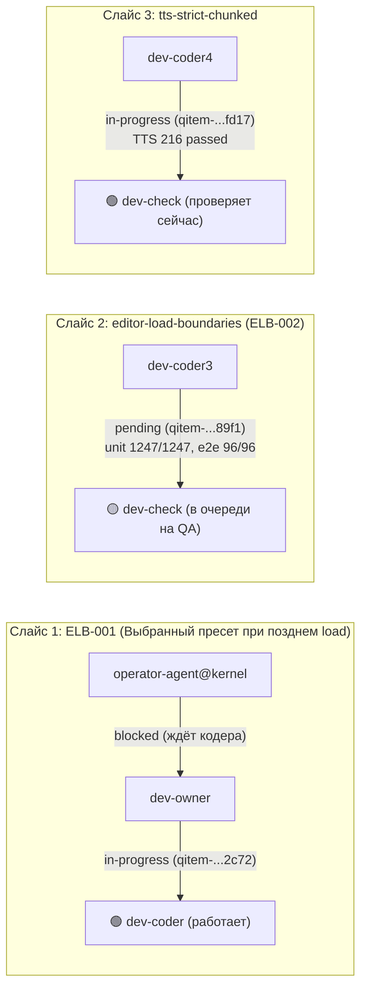
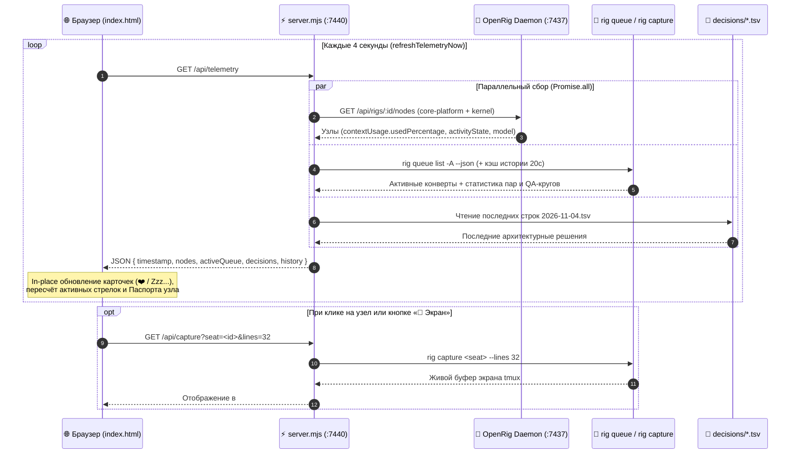
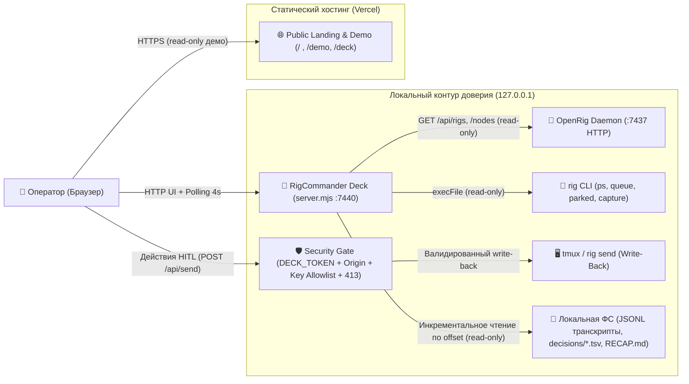
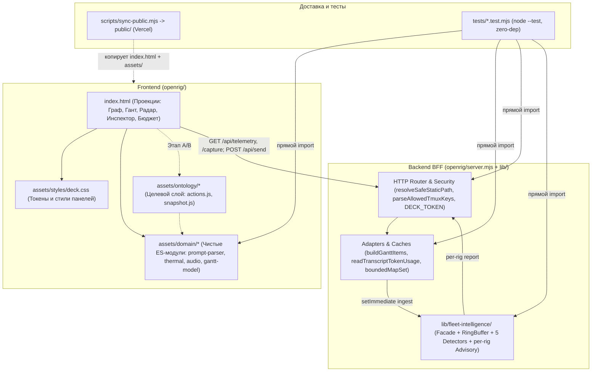

# Как устроен и работает наш OpenRig (`core-platform`)

Ниже — живая карта вашего локального конвейера разработки на базе **OpenRig Daemon (`:7437`)**, собранная по текущей топологии (`rig ps`), очереди (`rig queue`) и правилам из [CULTURE.md](~/openrig-lab/core-platform/CULTURE.md) и [AGENTS.md](~/www/EnterpriseCore/cores/CorePlatform/core-platform/AGENTS.md).

---

## 1. Общая топология: Kernel + CorePlatform Pod

Вся система крутится вокруг демона OpenRig (`127.0.0.1:7437`), который связывает агентов в разных терминалах (`tmux`) через общую очередь задач **L3 Queue (`rig queue`)** и прямую отправку в терминал (`rig send`).

> [!NOTE]
> **Разнообразие рантаймов и провайдеров:**
> Команда специально разведена по разным квотам и провайдерам, чтобы не выбивать один общий 5-часовой лимит:
> - `dev-coder` сидит на подписке **GLM Coding Plan** (`glm-5.3-flash` через `~/.claude-glm`).
> - `dev-coder3` работает в рантайме **Pi** на балансе `z.ai`.
> - `dev-check` работает в **Codex** на модели `gpt-6.1-terra` (`effort: high`) через баланс **APIKO** (с автоматическим фолбэком на ChatGPT Sol через `check-provider.sh`).
> - `dev-owner`, `dev-operator` и `dev-coder4` работают на **Codex (`gpt-6.1-sol`)**.

---

## 2. Жизненный цикл одного слайса (От идеи до `origin/dev`)

Вся работа движется **строго через строки очереди (`rig queue`)**, а не устными сообщениями в чате. Любой круг правок (даже мелкий 3-й раунд) обязательно проходит через `dev-check`.

---

## 3. Изоляция рабочих копий и портов

Чтобы параллельные кодеры и проверяющий не конфликтовали за файлы и порты Playwright/Vite, среда разделена физически:

| Участник | Рабочая директория (`cwd`) | Порты Playwright (`PW_PORT` / `PW_DEV_PORT`) | Как сдаёт и чистит контекст |
| :--- | :--- | :---: | :--- |
| **`dev-owner`** | `core-platform` *(+ `/tmp` для приёмки)* | `4173` / `5199` *(приёмка: `4176` / `5202`)* | Принимает, делает `git pull --rebase` и пушит. Сжимается через `rig compact` |
| **`dev-coder`** | `core-platform` (основная) | `4173` / `5199` | Оставляет изменения в дереве, получает `/clear --raw` от owner |
| **`dev-coder3`** | `core-platform-coder3` (отдельная копия) | `4174` / `5200` | Работает в `detached HEAD`, сдаёт SHA коммита; сброс — перезапуск ноды оператором |
| **`dev-coder4`** | `core-platform-coder4` (отдельная копия) | `4175` / `5201` | Перед работой `git fetch && git checkout --detach origin/dev`, сдаёт SHA для `cherry-pick` |
| **`dev-check`** | `core-platform` | Через `tools/check-pw <PORT> <DEV_PORT>` (напр. `4178` / `5204`) | После слайса получает `/new --raw` + подтверждение Enter |

---

## 4. Что происходит прямо сейчас в очереди (Live Snapshot)

На текущий момент в `rig queue` одновременно крутятся **3 параллельных потока**:

---

## 5. Четыре главных защитных механизма («Уроки в механику»)

1. **Доказательный QA (`dev-check`):**
   - Никаких «по коду кажется, что упадёт». Каждая находка P1–P3 обязана иметь **падающий тест** в `docs/tasks/qa/<slice>/check/`.
   - Обязательный **негативный контроль**: проверяющий сам временно ломает проверяемую фичу, убеждается, что тест краснеет, и возвращает файл обратно.
   - Обязательная **матрица границ** по `testing/boundary/values.json` без пустых клеток.
2. **Защита от раздувания контекста (Token Burn Protection):**
   - Кодеры получают `/clear` после каждого слайса.
   - `dev-check` получает `/new --raw` с проверкой появления нового `rollout-*.jsonl`.
   - Каждые 15 минут сторож (`watchdog`) будит `dev-operator`, а скрипт `context-sweep.py` следит за тем, чтобы свободные ноды не копили сотни тысяч токенов кэша.
3. **Песочница без лишних остановок:**
   - Никаких `python3 -c` или пайпов `| tail` / `2>&1` в тестовых командах, чтобы не триггерить запрос разрешений и не останавливать конвейер.
   - Браузерные прогоны у `dev-check` идут строго через обёртку `tools/check-pw`.
4. **Два журнала правды:**
   - **Что произошло** — хранится в `rig queue` и `docs/tasks/qa/<slice>/`.
   - **Почему принято решение** (приёмка, ещё круг, фолбэк провайдера) — пишется в `~/openrig-lab/core-platform/decisions/YYYY-MM-DD.tsv`.

---

## 6. Архитектура синхронизации дашборда (`index.html` ⇄ `server.mjs` ⇄ OpenRig)

Дашборд [index.html](./openrig/index.html) синхронизируется с ригом через легковесный мост [server.mjs](./openrig/server.mjs) (`127.0.0.1:7440`), который напрямую опрашивает демон OpenRig (`127.0.0.1:7437`), CLI `rig` и TSV-журнал решений:

## 7. Deck v3.2: что добавлено поверх 4-секундного цикла

| Функция | Источник данных | Где в коде |
|---|---|---|
| Живой радар «Кто кого держит» | `activityState.needsInput`, `activeQueue`, `contextUsage.usedPercentage ≥ 70`, `state=working` без строки очереди | `buildLiveRadar()` |
| Темп выгорания контекста и время с последнего свапа | история замеров `ctxPct` в браузере (сбрасывается при падении >5%), `activityState.lastSwap.at` | `computeBurn()`, Паспорт узла |
| Auto-Follow терминала | `/api/capture?lines=32` каждые 4 с, если выбранный агент `working`/`urgent` | `fetchTerminalCapture(id, silent)` |
| Терминал на 80 строк | `/api/capture?lines=80`, обновляется в цикле, пока окно открыто | `openTerminalModal()` |
| Рентген стрелки | `history.pairEnvelopes` (последние 4 конверта на пару, из `rig queue list -a --limit 300`) + открытые строки очереди | `selectEdge()`, `renderEdgeXray()` |
| Аудио-радар и заголовок вкладки | новые `ATTN` / `CTX ≥ 75%` (сигнал только при появлении, без повтора) | `updateAlertsAndTitle()`, `playBeep()` |

Темп выгорания считается только по замерам, накопленным с момента открытия страницы. После перезагрузки страницы ему нужно несколько минут, чтобы появилась оценка.

---

## 8. Контекстная диаграмма (C4 Level 1 — System Context & Trust Boundaries)

Показывает границы системы **RigCommander**, разделение **read-only телеметрии** и **защищённого write-back контура**, а также режим статического демо на Vercel.

### Инварианты границ доверия
- **Нет внешнего биндинга:** сервер слушает строго `127.0.0.1:7440`.
- **Разделение чтения и записи:** весь сбор телеметрии идёт без мутации состояния агентов; любая запись проходит через `POST /api/send` с per-process `DECK_TOKEN` (`timingSafeEqual`), проверкой `Origin`, ограничением тела `64KB` (`413`) и allowlist клавиш (`parseAllowedTmuxKeys`).
- **Изоляция статики:** `resolveSafeStaticPath` блокирует `..`, скрытые файлы (`.env`, `.git`) и исходники `.mjs`.

---

## 9. Компонентная диаграмма и карта зависимостей (C4 Level 3 — Components)

Описывает фактическую модульную структуру проекта и целевые границы при дальнейшей декомпозиции (связано с [Операционной онтологией](operational-ontology.md)).

### Правила зависимостей (Dependency Rules)
1. **`assets/domain/` не зависит от DOM и `window`:** все модули чистые, детерминированные и импортируются напрямую в `node --test`.
2. **Один источник правды для копий:** правки вносятся только в `openrig/` и `landing/`, а `public/` обновляется командой `npm run sync:public`.
3. **Аналитика не блокирует HTTP:** `FleetIntelligenceEngine.ingestSnapshot` выполняется через `setImmediate` с троттлингом и кэшем по `rigId`.
4. **Действия строго по предусловию:** кнопки write-back в UI появляются только при наличии конкретной причины (`urgent`, `working`, `ctxPct >= 65%`, `parked`) и в дальнейшем сводятся в единый реестр `assets/ontology/actions.js`.
