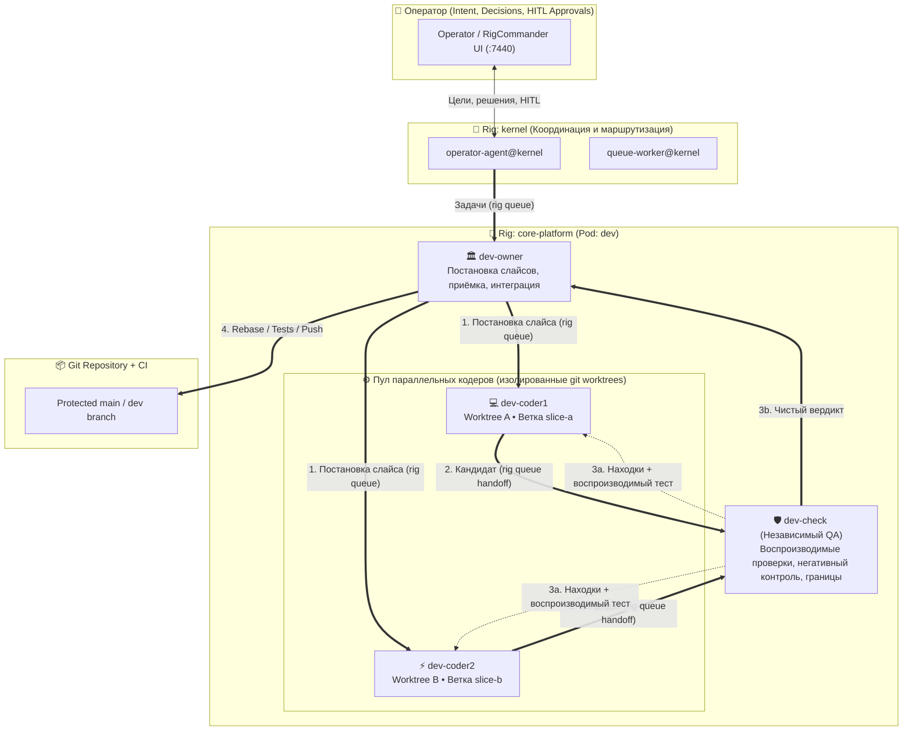
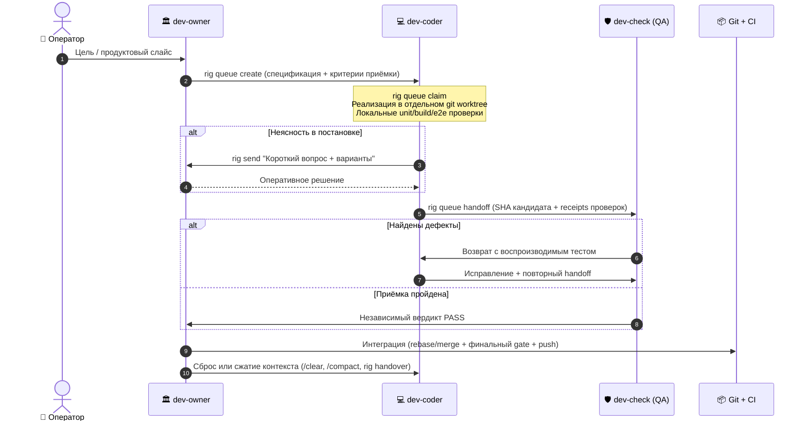
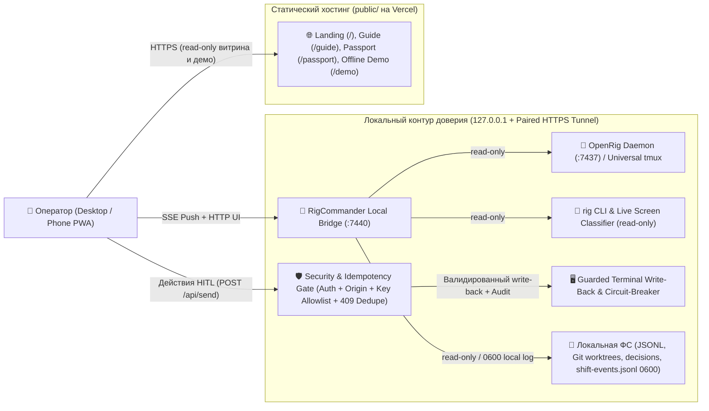
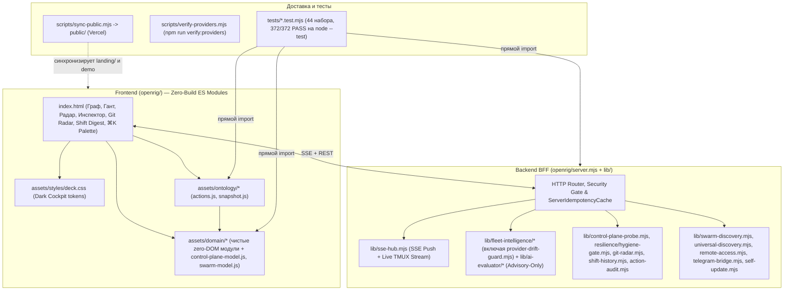

# Архитектура RigCommander и эталонного конвейера OpenRig

Документ описывает эталонную архитектуру **RigCommander (`v3.2`)** поверх **OpenRig Daemon (`127.0.0.1:7437`)** и режима **Universal Discovery** (`tmux` + JSONL транскрипты без OpenRig).

> **Связанные инженерные документы:**
> - Архитектурные решения (ADR): [adr/README.md](./adr/README.md)
> - Практический мануал по OpenRig CLI (`@openrig/cli`): [openrig-playbook.md](./openrig-playbook.md)

---

## 1. Эталонная топология мультиагентного флота (Kernel + Project Pod)

В режиме OpenRig локальный демон (`127.0.0.1:7437`) связывает агентов в отдельных терминальных сессиях (`tmux`) через долговечную очередь задач **L3 Queue (`rig queue`)** и контролируемый ввод (`rig send`). В режиме **Universal** (`--universal` или при отсутствии демона) RigCommander автоматически строит аналогичную карту напрямую по живым `tmux`-панелям и локальным JSONL-транскриптам.



> **Разделение квот и провайдеров:**
> Для устойчивости флота роли часто разносят по разным рантаймам и подпискам (например, Claude Code, Codex CLI, Pi, Gemini/Antigravity), чтобы исчерпание лимита одного провайдера не останавливало весь конвейер.

---

## 2. Жизненный цикл задачи (от постановки до интеграции)

Работа движется через долговечную очередь (`rig queue`), переживающую перезапуски и компакции контекста:



---

## 3. Изоляция рабочих копий и защита от конфликтов

Чтобы параллельные кодеры и проверяющий не перезаписывали файлы друг друга и не конфликтовали за dev-порты:
- Каждый активный исполнитель работает в изолированном `git worktree` (или отдельной ветке/копии) с собственным диапазоном портов для dev-сервера и e2e-тестов.
- **Git Worktree & Conflict Radar** ([ADR-0013](./adr/0013-git-worktree-and-conflict-radar.md)) в RigCommander отслеживает dirty-файлы и заблаговременно подсвечивает пересечения путей между параллельными worktree ещё до merge/rebase.
- **Контроль контекста:** после завершения слайса контекст сжимается (`/compact`) или обновляется (`rig handover` / чистая сессия), чтобы избежать деградации качества и лишнего расхода токенов кэша.

---

## 4. Архитектура синхронизации RigCommander (`UI` ⇄ `server.mjs` ⇄ `OpenRig / tmux`)

Пульт [index.html](../index.html) работает через легковесный локальный BFF [server.mjs](../server.mjs) (`127.0.0.1:7440`, `0 npm deps`). Начиная с **v3.2** ([ADR-0016](./adr/0016-sse-push-and-live-tmux-streaming.md)), доставка обновлений переведена на **SSE Push + дедуплицированный Live TMUX Stream** с автоматическим fallback на редкий polling:

```mermaid
sequenceDiagram
    autonumber
    participant UI as 🌐 Браузер (index.html)
    participant Srv as ⚡ server.mjs + SsePushHub (:7440)
    participant Dm as 🧠 OpenRig Daemon (:7437) / Universal tmux
    participant CLI as 🔧 rig CLI / tmux capture
    participant FS as 📂 JSONL + Git + ShiftHistory (0600)

    UI->>Srv: GET /api/events (SSE Push Stream)
    Note over Srv: 0% idle CPU при 0 подписчиках;<br/>SHA-1 дельта-дедупликация + heartbeat 18s

    loop При активных SSE-клиентах
        par Параллельный read-only сбор
            Srv->>Dm: Топология узлов, активность, contextUsage
        and
            Srv->>CLI: Очередь задач, parked, классификация экранов
        and
            Srv->>FS: Инкрементальные JSONL (offset), Git worktrees, shift-events.jsonl
        end
        Srv-->>UI: event: telemetry / shift_event (только при изменении)
        UI->>Srv: GET /api/telemetry (при получении дельты)
        Srv-->>UI: Полный снапшот (nodes, queue, finops, gitRadar, advisory)
    end

    opt Открыт инспектор (Auto-Follow) или модалка LIVE TMUX (80 строк)
        UI->>Srv: GET /api/capture/stream?seat=<id>&lines=80
        Note over Srv: 1 общий watcher на seat для всех вкладок;<br/>адаптивный backoff 650ms -> 1500ms
        Srv->>CLI: rig capture / tmux capture-pane
        Srv-->>UI: event: screen (только при новом SHA-1 экрана)
    end

    opt Оператор нажимает HITL-действие / отправляет команду
        UI->>Srv: POST /api/send (Session Auth + X-Idempotency-Key)
        Srv->>CLI: Валидированный write-back (allowlist клавиш)
        Srv-->>UI: HTTP 200 + мгновенная инвалидация и досрочный re-capture (120ms / 520ms)
    end
```

---

## 5. Контекстная диаграмма и границы доверия (C4 Level 1)

Разделение **read-only телеметрии**, **защищённого write-back контура** и **статической витрины (Vercel)**:



### Ключевые инварианты безопасности
- **Loopback-only по умолчанию:** сервер слушает строго `127.0.0.1:7440`; удалённый доступ с телефона открывается только после явного спаривания по одноразовому QR + PIN с `HttpOnly; Secure` cookie и отзывом в 1 клик.
- **Строгое разделение чтения и записи:** сбор телеметрии, FinOps, Git Radar и SSE-потоки не мутируют состояние агентов; любая запись проходит через Security Gate, проверку идемпотентности и автоматическую верификацию postcondition в `ActionAuditLog`.
- **Zero-Build и Zero-Dep:** `0` внешних npm-зависимостей, нативные ES-модули браузера и Node.js `>= 18`.

---

## 6. Компонентная карта (C4 Level 2/3) и правила зависимостей



### Четыре архитектурных правила
1. **Чистый слой `assets/domain/` и `assets/ontology/`:** доменные модули не обращаются к DOM/`window` и тестируются напрямую в `node --test`.
2. **Единый источник правды:** правки вносятся только в `openrig/` и `landing/`; папка `public/` генерируется детерминированно командой `npm run sync:public` (при этом `openrig/docs/` никогда не копируется в `public/`).
3. **Неблокирующая аналитика и 0% CPU в простое:** детекторы `FleetIntelligenceEngine` работают внеполосно с изоляцией сбоев, а `SsePushHub` останавливает фоновые циклы при отсутствии активных клиентов.
4. **Действия по предусловию и с аудитом:** все контролы берутся из единого реестра действий; у здорового `idle`-узла `0` лишних кнопок вмешательства; дубли блокируются на клиенте и сервере.
