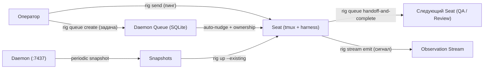

# OpenRig Playbook: от базового пульта до нестандартных флоу

> **Фундамент RigCommander:** OpenRig (`@openrig/cli`, проверено на `v0.7.6`) — локальный control plane уровня L3, поверх которого построен визуальный командный пульт RigCommander. В примерах ниже используются канонические имена ригов `kernel` и `core-platform`.

---

## 1. Ментальная модель за 60 секунд

OpenRig — это **не чат-бот и не «ещё один терминал»**, а **локальный control plane уровня L3** (аналог `docker compose` / `kubectl` для ИИ-агентов в `tmux`):

| Слой | Кто это | Роль |
|---|---|---|
| **L0 — Model** | Claude, GPT-6.x, GLM, Gemini | Безсостоятельный движок токенов |
| **L1 — Agent Core** | Цикл рассуждений агента | Наблюдение → план → действие |
| **L2 — Harness** | `claude`, `codex`, терминал | Инструменты, память, права, сессия |
| **L3 — OpenRig** | Демон (`:7437`) + SQLite + `tmux` | Топология команды, очереди, снапшоты, восстановление |

### Пять терминов, которые нужно понимать буквально
1. **Rig (`rig`)** — вся команда/система целиком (например, `kernel` или `core-platform`). Бывают 5 классов: `kernel` (управляющий узел хоста), `project` (команда под репозиторий), `ephemeral` (разовая миссия), `infra-build`, `managed-app`.
2. **Pod (`pod`)** — **контекстный домен**, а не «этап пайплайна». В один pod кладут агентов, которые общаются почти каждый ход и разделяют общий рабочий контекст.
3. **Seat / Member (`seat`)** — постоянное «кресло»/роль (`dev.coder4`, `dev.owner`). **Occupant** (конкретный процесс Claude/Codex внутри) может меняться при компакции, смене рантайма или handover, а адрес кресла, его очередь и связи остаются прежними.
4. **Canonical Session Name** — адрес вида **`{pod}-{member}@{rig}`** (например, `dev-coder4@core-platform`, `operator-agent@kernel`). В логической записи для конфигов и некоторых команд встречается форма `{pod}.{member}@{rig}` (например, `dev.coder4@core-platform`).
5. **Qitem (`qitem`)** — долговечная единица работы в SQLite-очереди демона (`pending → in-progress → blocked → done`). В отличие от сообщений в чат, переживает перезагрузки, компакции и смену исполнителя.



---

## 2. Ежедневный цикл и визуальный пульт

### Главный цикл жизни рига
```bash
rig daemon status                       # жив ли демон (:7437)
rig daemon start                        # поднять демон и проверить окружение
rig ps                                  # сводка по активным ригам
rig ps --nodes --rig <name>             # детально по всем креслам одного рига
rig terminal open saved:kernel --window # открыть GUI-плитку (TUI + operator + advisor)
```

> **Просмотр без захвата экрана:** `rig terminal views` покажет все доступные виды (`saved:kernel`, `rig:core-platform` и т.д.). Команда `rig terminal open rig:core-platform --window` откроет окно/вкладку с тайлами агентов. Резервный консольный дашборд (включая SSH) — `rig tui --shared` (выход без остановки: `Ctrl-b d`).

### Быстрые команды внутри TUI-дашборда (`rig tui commands`)
- `attention` (`needs`, `feed`) — что требует вашего решения прямо сейчас;
- `reply <текст>` — ответить на открытый запрос из Feed прямо из дашборда;
- `tab graph` (или `g`) — граф топологии и связей между агентами;
- `cost` / `usage` / `usage-hosts` — расход токенов, окна лимитов и стоимость по креслам;
- `terminals` / `terminal rig:<name>` — открыть терминальные плитки нужного рига;
- `projects` / `mission <name>` / `workflow <id>` — навигация по миссиям и пайплайнам.

### Остановка, архивация и восстановление
```bash
rig down <rig>                              # штатно остановить риг (делает снапшот)
rig down <rig> --snapshot                   # принудительно зафиксировать снапшот перед остановкой
rig archive <rig>                           # скрыть остановленный риг из rig ps, сохранив историю
rig unarchive <rig>                         # вернуть из архива (rig ps --include-archived)

rig start --last                            # восстановить всё, что работало до ребута
rig up <rig> --existing                     # восстановить существующий риг (критично для kernel!)
rig up <rig> --existing --plan              # dry-run: показать план восстановления без запуска
rig up <rig> --existing --fresh dev.coder2  # всех поднять из истории, а dev.coder2 — начисто
```

> **Почему `--existing` критичен для `kernel`:** слово `kernel` есть и в библиотеке шаблонов (`rig specs ls`), и как имя существующего рига. Без `--existing` команда `rig up` может попытаться развернуть новый риг по спеке вместо восстановления старого.

---

## 3. Честное восстановление: 5 статусов и проверка `rig parked`

OpenRig никогда не подменяет молча остановившегося агента пустой сессией без решения оператора:

1. `resumed` — родной харнесс поднял ровно тот же диалог.
2. `fresh-primed` — запущена чистая сессия с загруженным стартовым контекстом роли.
3. `awaiting-decision` — кресло ранее **было остановлено намеренно**. OpenRig ждёт явного решения:
   ```bash
   rig seat launch dev.coder@core-platform --fresh --reason "нужен на текущую задачу"
   ```
4. `attention_required` — кресло поднялось, но требует проверки оператора (например, `stale_runtime_hook`).
   **Правильное лечение (никогда не правьте SQLite руками):**
   ```bash
   rig capture dev-owner@core-platform --lines 40
   # убедиться глазами, что агент в живом idle-состоянии и не ждёт ответа на диалог выбора
   rig seat clear-attention dev-owner@core-platform --reason "confirmed live idle after restore"
   ```
5. `failed` — транспорт или запуск реально сломались.

**Быстрая проверка «а мы не застряли?»:**
```bash
rig parked --rig core-platform
```
Команда подсветит остановленные кресла, на которых висят открытые задачи, и отличит мёртвую блокировку от здорового `HELD` (у которого тикает живой таймер или ждётся другой активный `qitem`).

---

## 4. Базовые рабочие сценарии

### Сценарий A: Новый проект за 1 минуту (из готовой спеки)
```bash
rig specs ls                                         # посмотреть встроенные и ваши YAML-спеки
rig specs preview starter --kind rig                 # изучить состав команды до запуска
rig up starter --cwd /abs/path/to/repo --plan        # предпросмотр без запуска
rig up starter --cwd /abs/path/to/repo --non-interruptive
```

### Сценарий B: Правильная постановка задач — «Чат vs Очередь»

| Критерий | `rig send <seat> "..."` | `rig queue create / handoff` |
|---|---|---|
| Назначение | Быстрый вопрос, пинг в соседний tmux-тайл | Поручение работы, баг-репорт, ревью, эскалация |
| Переживает рестарт/компакцию | Нет (просто текст в буфер терминала) | Да (SQLite + цепочка `handed_off_from` / `to`) |
| Защита от меню выбора | **Да (send-guard):** откажет при confirmation prompt | Хранится в инбоксе, пока кресло не освободится |
| Где видно | Только экран агента | `rig queue list`, RigCommander Deck, Feed |

**Эталонный паттерн (безопасное тело через `--body-file` + теги):**
```bash
cat <<'EOF' > /tmp/task-auth-fix.md
Почини редирект после OAuth в /login.
Done criteria:
1. Зелёные тесты auth.spec.ts
2. Приложить git commit SHA в handoff
EOF

rig queue create \
  --destination dev-coder4@core-platform \
  --summary "Fix OAuth redirect on /login" \
  --mission auth-v2 --slice login-redirect \
  --body-file /tmp/task-auth-fix.md
```
> Многострочный текст и обратные кавычки `` ` `` в `--body "..."` ломаются о shell/парсер — для всего длиннее одной строки всегда используйте `--body-file` (или `--body-file -` через stdin).

**Принцип «Горячей картошки» (Hot-Potato):** агент не завершает работу в тишине — либо закрывает задачу финально (`--state done --closure-reason no-follow-on`), либо атомарно передаёт дальше:
```bash
rig queue handoff-and-complete <qitemId> \
  --to dev-check@core-platform \
  --summary "Verify OAuth redirect fix on dev" \
  --body-file /tmp/handoff-proof.md
```

**Если работа упёрлась во внешний процесс (CI, деплой, человек) — честный `HELD` с будильником:**
```bash
rig queue block <qitemId> --on external:ci-build --wake-after 10m --continuation "проверить статус CI и двинуть в QA"
rig queue resolve <qitemId> --note "CI green, можно тестировать"
```

### Сценарий C: Инспекция и «археология» без отвлечения агентов
```bash
rig capture dev-coder5@core-platform --lines 60   # что прямо сейчас на экране
rig transcript dev-coder4@core-platform --tail 80 # последние сообщения из транскрипта
rig ask core-platform "почему отказались от WebSocket в пользу SSE?"
rig ask core-platform "история правок авторизации" --seat dev-owner@core-platform
```
*`rig ask --seat` ищет сквозь **все поколения** агентов, когда-либо сидевших в этом кресле.*

### Сценарий D: Дебаты (`chatroom`) и поток наблюдений (`stream`)
```bash
rig chatroom topic core-platform "ARCH: схема БД v2"
rig chatroom send core-platform "Предлагаю денормализовать баланс..." --sender dev-senior-architect@core-platform
rig chatroom watch core-platform

rig stream emit --source dev-coder4@core-platform --hint-type idea --body "Тест auth флаки из-за таймаута в mock Redis"
rig stream list
```

---

## 5. Десять продвинутых флоу

1. **«Усыновить» уже работающих в tmux агентов без перезапуска (`discover` / `adopt` / `release`):**
   ```bash
   rig discover --draft
   rig bind <discoveredId> --rig <rigId> --node dev.coder
   rig adopt ./rig.yaml --bind dev.coder=<tmuxSession>
   rig release <rigId>   # отпустить adopted-сессии живыми, не убивая терминалы
   ```
2. **Включить свой собственный shell как члена команды (`attach --self`):**
   ```bash
   rig attach --self --rig <rigId> --pod operator --member person-agent --runtime codex --print-env
   ```
   Экспортируйте `OPENRIG_NODE_ID` и `OPENRIG_SESSION_NAME` — агенты смогут делать `handoff` прямо в ваш `--owned` инбокс, а `rig down` не закроет ваш внешний терминал.
3. **Горячее масштабирование живого рига без `rig down` (`grow` / `expand` / `remove`):**
   ```bash
   rig grow core-platform coder6 --pod dev --runtime codex --cwd /path/to/repo
   rig expand core-platform ./qa-pod-fragment.yaml
   rig add core-platform dev ./specialist-member.yaml
   rig remove core-platform dev.coder6
   ```
4. **«Пересадка мозга» на живом кресле без потери адреса (`set-runtime` / `set-model` / `provider`):**
   ```bash
   rig seat set-runtime dev-coder4@core-platform --runtime claude-code --reason "Codex quota exhausted" --dry-run
   rig seat set-runtime dev-coder4@core-platform --runtime claude-code --reason "Codex quota exhausted"
   rig seat set-model dev-coder4@core-platform --model gpt-6.2-sol --reason "upgrade model"
   rig provider status && rig provider precheck dev-coder4@core-platform
   ```
   Работает по протоколу **Successor-First**: новый процесс прогревается с handover-пакетом, входящие сообщения придерживаются, и только после `--confirm` старый процесс уходит на пенсию.
5. **«Раздвоить» прогретого агента для параллельной гипотезы (`fork`):**
   ```bash
   rig fork dev-coder4@core-platform --rig core-platform --pod dev --member coder4-spike --keep-image
   ```
6. **Контекстная эстафета и защита от деградации (`compact` / `watchdog` / `handover`):**
   ```bash
   rig compact dev-check@core-platform
   rig watchdog register --policy context-usage-threshold --target-session dev-coder4@core-platform --threshold-percent 70 --interval-seconds 60 --message "Контекст >70%. Зафиксируй артефакты и сделай handover или compact."
   rig handover dev-coder4@core-platform --source fork:dev-coder4@core-platform --reason "чистый преемник"
   # --source: fresh | fork:<id> | rebuild | discovered:<id>
   ```
7. **«Некромантия одного вопроса» (`rig ask --wake`):**
   ```bash
   rig ask core-platform "Почему выбрали BRIN-индекс в таблице платежей?" --wake dev-senior-architect@core-platform
   ```
   Точечно будит одно остановленное кресло, получает ответ из его оригинального контекста и снова усыпляет (`--wake-timeout 180s`).
8. **Дозированное скармливание больших пачек контекста (`context` + `walk`):**
   ```bash
   rig context compose --out packs/payment-onboarding --from ./ADR-01.md ./API-contract.md ./test-plan.md
   rig walk dev-coder5@core-platform --through packs/payment-onboarding --pace 12s
   rig queue create --destination dev-coder5@core-platform --summary "Implement payment flow" --body-context packs/payment-onboarding
   ```
9. **Одноходовый вызов внешнего ACP-агента на строку очереди (`rig acp`):**
   ```bash
   rig acp run <qitemId> <agent-command...>
   ```
10. **Пробивка застрявших промптов, мульти-хост и аварийный чемоданчик (`--dangerously-interact`, `host`, `crash-cart`):**
    ```bash
    rig capture dev-coder4@core-platform --lines 25
    rig send dev-coder4@core-platform "1" --dangerously-interact --reason "подтвердил выбор #1 после визуальной проверки"
    rig host pair https://<remote-daemon-url> && rig host ls
    rig crash-cart --json   # read-only диагностика БД + живых tmux-сессий до подъёма демона
    ```

---

## 6. Топ-7 антипаттернов (на чём чаще всего обжигаются)

1. **Ставить задачи через `rig send` вместо `rig queue create`.** Текст потеряется при компакции или рестарте, а `rig parked` не узнает о зависании.
2. **Жонглировать `--force` и `--no-nudge`.** В `rig send` флаг `--force` не пробивает меню выбора (для этого только `--dangerously-interact --reason`); в `rig queue` уведомление включено по умолчанию, а `--no-nudge` оставит исполнителя спать.
3. **Запускать `rig broadcast "..."` без `--rig` / `--pod`.** Без фильтров сообщение улетит всем живым агентам во всех ригах («broadcast storm»). Для выборочной рассылки — `rig send --to seat1,seat2 "..."`.
4. **Передавать многострочный текст с `` ` `` в `--body`.** Всегда используйте `--body-file`, а крупные логи передавайте ссылкой на путь файла.
5. **Путать `rig down --delete` и `rig archive`.** `--delete` стирает историю безвозвратно; для уборки отработавшего рига нужен `rig archive`.
6. **Верить проекциям `rig ps` вместо живого терминала.** Истина последней инстанции — `rig capture <seat>` (или Live TMUX в RigCommander) и `rig parked`.
7. **Восстанавливать `kernel` без `--existing` и править SQLite вручную.** Используйте `rig up kernel --existing` и `rig seat clear-attention <seat> --reason "..."`.
